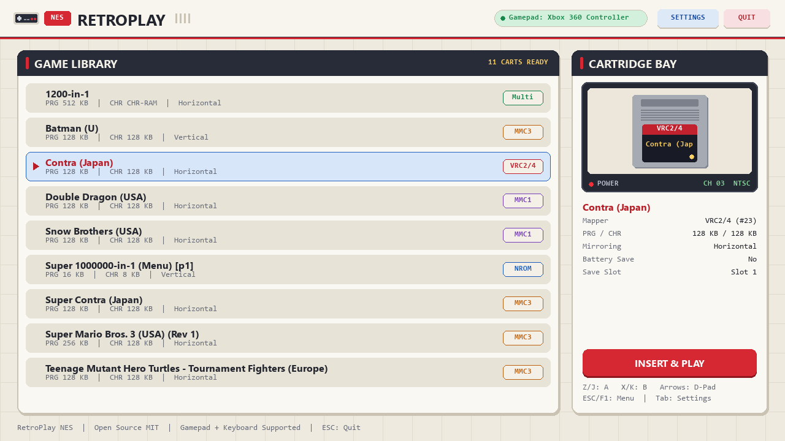
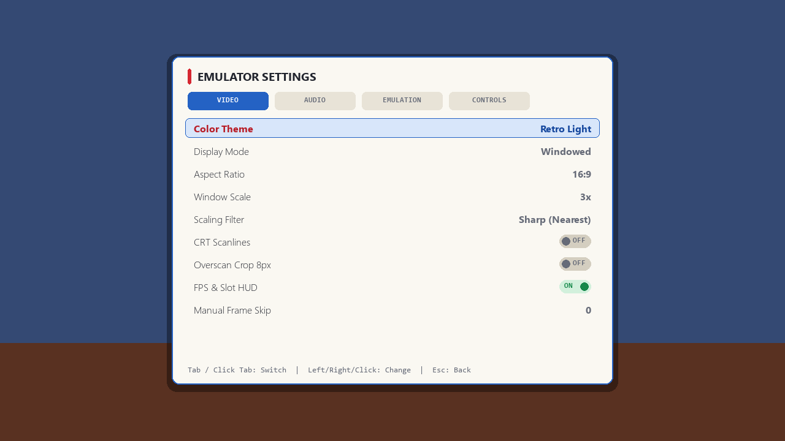

# RetroPlay — NES Emulator

[](https://github.com/rajeshsani7-lab/Retroplay-nes-emulator/actions/workflows/ci.yml)
[](LICENSE)

An open-source **NES (Nintendo Entertainment System) emulator** written in Python, accelerated with **Numba JIT** for locked 60.1 FPS gameplay, crisp 44.1 kHz audio, universal controller support, and a nostalgic **Retro Light** hardware interface.

Created and maintained by **Rajesh Sani ([@rajeshsani7-lab](https://github.com/rajeshsani7-lab))**.

---

## Interface Showcase

| Game Library (`Retro Light`) | Video & Theme Settings (`ESC` / `F1`) |
|---|---|
|  |  |

---

## Features

- **MOS 6502 CPU** — All official opcodes + Numba JIT execution (`nes_core/cpu_jit.py`) with automatic pure-Python fallback
- **PPU (Graphics)** — Loopy `v`/`t` scrolling (mid-frame HUD splits), Sprite 0 hit, background/sprite priorities, and Numba JIT scanline rendering
- **APU (Audio)** — Pulse 1 & 2 (duty, sweep, envelope), Triangle, and 15-bit NES LFSR Noise with 240Hz/120Hz frame sequencer, low-pass warmth filter, master volume slider, and per-channel mutes
- **Wide Mapper Support** — Mappers **0** (NROM), **1** (MMC1), **2** (UxROM), **3** (CNROM), **4** (MMC3 + scanline IRQ), **9** (MMC2), **23** (Konami VRC2b/VRC4e), and **227** (Multicarts)
- **Retro Light & Midnight Dark Themes** — Classic NES cream/red light theme by default, switchable live in **Settings → Video → Color Theme**
- **Graphical ROM Library & 4-Tab Settings (`ESC` / `F1`)** — Cached gameplay cover previews, styled NES cartridge art, mouse/keyboard/gamepad menu navigation, saved in `settings.json`
- **Display Options** — Windowed (`2x`/`3x`/`4x`) & Fullscreen (`F11`), Aspect Ratio (`16:9` / `4:3` / `1:1 Pixel`, `F10`), Sharp vs Smooth scaling, CRT Scanlines (`F9`), 8px Overscan Crop, and FPS HUD (`F3`)
- **9 Save State Slots (`F7` / `F8`) & Battery `.sav`** — Persists CPU, RAM, PPU, CHR-RAM, mapper banks, and battery SRAM
- **Universal Controller Support** — Automatic plug-and-play for Xbox, PlayStation, Switch Pro, and generic USB/DirectInput gamepads (`nes_core/controllers.py`), plus live keyboard remapping

---

## Supported Mappers & Example Games

| Mapper | Name | Example Games |
|--------|------|---------------|
| 0 | NROM | Super Mario Bros., Ice Hockey, Donkey Kong, Excitebike |
| 1 | MMC1 | Snow Brothers, Teenage Mutant Ninja Turtles, Zelda, Metroid |
| 2 | UxROM | Contra (US), Mega Man, Castlevania, Duck Tales |
| 3 | CNROM | Donkey Kong Jr., Popeye |
| 4 | MMC3 | Super Mario Bros. 3, Super Contra, TMNT III, Kirby's Adventure |
| 9 | MMC2 | Mike Tyson's Punch-Out!! |
| 23 | VRC2b/VRC4e | Contra (Japan) |
| 227 | Multicart | 1200-in-1, 57-in-1 |

---

## Quick Start

## How to Play (3 Easy Steps)

### Option A — No Coding / One-Click (Recommended)
1. **Download**: On GitHub, click **Code → Download ZIP** (or grab the latest `RetroPlay-NES-Windows.zip` from **Releases**), and extract the folder.
2. **Add your `.nes` games**: Copy your legally-owned `.nes` ROM files into the `roms/` folder:
   ```text
   Retroplay-nes-emulator/
     roms/
       contra.nes
       mario3.nes
   ```
3. **Play**:
   - **Windows**: Double-click **`play.bat`** (automatically installs dependencies on first run and opens the Game Library; or double-click `play_fullscreen_16x9.bat` for fullscreen).
   - **Mac / Linux**: Run `./play.sh` (or `chmod +x play.sh && ./play.sh`).
   - Plug in any **USB / Bluetooth controller** or play with **Arrow Keys + `Z` (A) / `X` (B) / `Enter` (Start)**.

### Option B — Developer Setup (`git clone`)

```bash
git clone https://github.com/rajeshsani7-lab/Retroplay-nes-emulator.git
cd Retroplay-nes-emulator
pip install -r requirements.txt
python main.py                  # Open graphical Game Library
python main.py roms/contra.nes  # Or launch a ROM directly
```

---

## Controls & Hotkeys

### Player 1 (Default — Remappable in Settings)
| Key | NES Button |
|-----|-----------|
| Arrow Keys | D-Pad |
| `Z` / `J` | A |
| `X` / `K` | B |
| `Enter` | Start |
| `Right Shift` / `Space` | Select |

*Any connected USB or Bluetooth controller works automatically (`Start+Select` or Guide button opens the Pause Menu).*

### Emulator Hotkeys
| Key | Action |
|-----|--------|
| `ESC` / `F1` | Open Pause & Settings Menu |
| `F11` | Toggle Fullscreen / Windowed |
| `F10` | Cycle Aspect Ratio (`16:9` / `4:3` / `1:1`) |
| `F9` | Cycle CRT Scanlines (`Off` / `Light` / `Classic`) |
| `F7` / `F8` | Save / Load State (current slot) |
| `F5` | Reset Console |
| `F12` | Take Screenshot |
| `F3` | Toggle FPS & Slot HUD |
| `M` | Mute / Unmute Audio |
| `Tab` (hold) | Fast Forward (`2x` / `3x` / `4x`) |
| `P` | Quick Pause / Resume |

---

## Running Tests

```bash
python -m unittest discover -s tests -v
```

---

## Contributing & Ownership

Everyone is welcome to **fork** this repository to customize themes, add custom mappers, or tailor controls to their own taste, and submit Pull Requests. See [CONTRIBUTING.md](CONTRIBUTING.md) for guidelines.  
All Pull Requests are reviewed and merged solely by repository owner **[@rajeshsani7-lab](https://github.com/rajeshsani7-lab)**.

---

## Legal Notice

This emulator is **100% open source** under the [MIT License](LICENSE) and **does not include any copyrighted game ROMs**. Users must supply their own legally-obtained `.nes` files.
